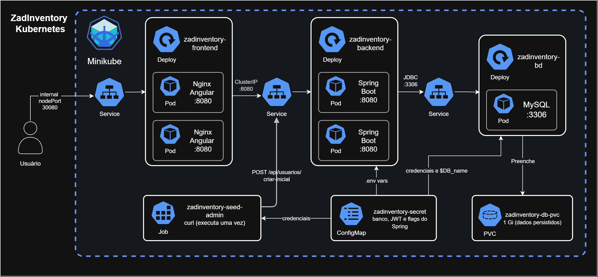

# zadinventory no Kubernetes (Minikube)

Sistema de gerenciamento de estoque (produtos, categorias, tags, operações e usuários) com **Spring Boot** no backend, **Angular** no frontend e **MySQL** como banco de dados.

Este repositório é a entrega do **Mensal 3**: a aplicação desenvolvida no Mensal 1, que rodava na GCP, foi adaptada para rodar inteiramente em um cluster Kubernetes local com **Minikube**. Nenhuma funcionalidade nova foi criada; só a infraestrutura mudou.

## Como a aplicação roda no cluster



| Recurso | Tipo | Função |
| --- | --- | --- |
| `zadinventory-frontend` | Deployment (2 réplicas) + Service NodePort | Nginx servindo o Angular e repassando `/api/` ao backend |
| `zadinventory-backend` | Deployment (2 réplicas) + Service ClusterIP | API Spring Boot |
| `zadinventory-db` | Deployment (1 réplica) + PVC + Service ClusterIP | MySQL 8.4 com dados persistidos |
| `zadinventory-config` | ConfigMap | Configurações não sensíveis (URL do banco, flags do Spring) |
| `zadinventory-secret` | Secret | Usuário e senha do banco, chave do JWT |
| `zadinventory-seed-admin` | Job + Secret `zadinventory-admin` | Cria o usuário administrador inicial |

## Estrutura do repositório

```text
zadinventory-backend/    Dockerfile + zadinventory/ (Spring Boot)
zadinventory-frontend/   Dockerfile + default.conf (Nginx) + zadinventory/ (Angular)
docs/                    Diagrama, requisitos e evidências para entrega
k8s/                     Manifestos Kubernetes (01 a 06)
.github/workflows/       Pipeline de testes (GitHub Actions)
```

## Pré-requisitos

- Windows com PowerShell
- Docker Desktop (aberto e em execução)
- Minikube e kubectl
- Git
- Cerca de 4 GB de memória e 4 CPUs disponíveis para o Docker Desktop

## Passo a passo

Todos os comandos são em PowerShell.

### 1. Instalar as ferramentas

```powershell
winget install -e --id Docker.DockerDesktop
winget install -e --id Kubernetes.minikube
winget install -e --id Kubernetes.kubectl
winget install -e --id Git.Git
```

Reabra o terminal, com o Docker Desktop aberto, e confira:

```powershell
docker version
minikube version
kubectl version --client
git --version
```

### 2. Clonar o repositório

```powershell
git clone https://github.com/pepepedrinho/S8M3_Infraestrutura_Kubernetes.git
cd S8M3_Infraestrutura_Kubernetes
```

Execute os comandos seguintes sempre a partir dessa pasta.

### 3. Iniciar o cluster

```powershell
minikube start --driver=docker
kubectl cluster-info
kubectl get nodes
```

O nó `minikube` deve aparecer com status `Ready`.

### 4. Construir as imagens dentro do Minikube

O build roda direto no runtime do Minikube, então as imagens já ficam disponíveis para o cluster, sem precisar de registry.

```powershell
minikube image build -t zadinventory-backend:local ./zadinventory-backend
minikube image build -t zadinventory-frontend:local ./zadinventory-frontend

minikube image ls | Select-String zadinventory
```

A listagem deve mostrar as duas imagens (`zadinventory-backend:local` e `zadinventory-frontend:local`). O build leva alguns minutos, por causa do Maven e do `npm install`.

### 5. Aplicar os manifestos

```powershell
kubectl apply -f k8s/

kubectl rollout status deployment/zadinventory-db --timeout=180s
kubectl rollout status deployment/zadinventory-backend --timeout=300s
kubectl rollout status deployment/zadinventory-frontend --timeout=120s

kubectl wait --for=condition=complete job/zadinventory-seed-admin --timeout=300s
kubectl logs job/zadinventory-seed-admin

kubectl get all
```

O log do Job deve terminar com `HTTP 200`, indicando que o usuário administrador foi criado. Todos os Pods devem ficar em `Running` e `1/1`.

### 6. Abrir a aplicação

```powershell
minikube service zadinventory-frontend --url
```

Deixe esse terminal aberto e acesse no navegador a URL exibida. Faça login com o administrador criado pelo Job:

| Campo | Valor |
| --- | --- |
| E-mail | `admin@admin.com` |
| Senha | `admin` |

São credenciais de desenvolvimento local, definidas em `k8s/06-admin-job.yaml` (e as do banco e do JWT em `k8s/02-secret.yaml`).

## Demonstração

Comandos usados na apresentação.

### Pods, Services e Deployments

```powershell
kubectl get pods -o wide
kubectl get services
kubectl get deployments
```

### Balanceamento de carga entre os Pods

O Nginx responde com o header `X-Served-By`, que traz o nome do Pod que atendeu. As requisições partem de um Pod temporário dentro do cluster e passam pelo Service:

```powershell
kubectl get pods -l app=zadinventory-frontend

kubectl run teste-lb --rm -i --restart=Never --image=curlimages/curl --command -- sh -c 'for i in 1 2 3 4 5 6 7 8; do curl -sI http://zadinventory-frontend | grep -i x-served-by; done'
```

A saída alterna entre os nomes dos dois Pods do frontend. Os endereços que o Service usa:

```powershell
kubectl get endpoints zadinventory-frontend zadinventory-backend
```

### Exclusão de um Pod e recriação automática

```powershell
$pod = kubectl get pods -l app=zadinventory-frontend -o jsonpath='{.items[0].metadata.name}'
$pod

kubectl delete pod $pod --wait=false
kubectl get pods -l app=zadinventory-frontend -w
```

Pressione `Ctrl+C` para sair do `-w`. O Deployment cria um Pod novo para manter 2 réplicas. O mesmo funciona para o backend com `-l app=zadinventory-backend`.

### Comunicação entre os componentes

```powershell
kubectl exec deploy/zadinventory-frontend -- wget -qO- http://zadinventory-backend:8080/actuator/health

kubectl describe service zadinventory-backend
kubectl describe service zadinventory-db
kubectl get configmap,secret
kubectl logs deploy/zadinventory-backend --tail=20
```

O primeiro comando mostra o frontend chamando o backend pelo nome do Service, e o `{"status":"UP"}` confirma que o backend está de pé e conectado ao banco.

## Remover tudo ao terminar

Remover os recursos da aplicação (isso também apaga o volume do MySQL e os dados):

```powershell
kubectl delete -f k8s/
```

Parar o cluster, mantendo o estado para uma próxima vez:

```powershell
minikube stop
```

Apagar o cluster por completo, com as imagens construídas dentro dele:

```powershell
minikube delete
```

## Solução de problemas

```powershell
kubectl get pods
kubectl describe pod <nome-do-pod>
kubectl logs deploy/zadinventory-backend
kubectl logs deploy/zadinventory-db
kubectl get events --sort-by=.lastTimestamp
```

- **`ErrImageNeverPull` ou `ImagePullBackOff`:** as imagens não estão no Minikube. Refaça o passo 4 e confirme com `minikube image ls`.
- **Pod `Pending` ou reiniciando com `OOMKilled`:** falta memória. Recrie o cluster com mais recursos: `minikube delete` e depois `minikube start --driver=docker --cpus=4 --memory=4096` (depois refaça os passos 4 e 5).
- **Backend demora a ficar `Ready`:** é normal nos primeiros minutos, porque ele espera o MySQL inicializar. Acompanhe com `kubectl logs deploy/zadinventory-backend`.
- **Depois de alterar código:** refaça o build da imagem correspondente (passo 4) e reinicie o Deployment, porque a tag `local` não muda:

```powershell
kubectl rollout restart deployment/zadinventory-backend
kubectl rollout restart deployment/zadinventory-frontend
```

- **Rodar o Job do administrador de novo** (por exemplo, depois de recriar o banco): o Job precisa ser recriado.

```powershell
kubectl delete job zadinventory-seed-admin --ignore-not-found
kubectl apply -f k8s/06-admin-job.yaml
```